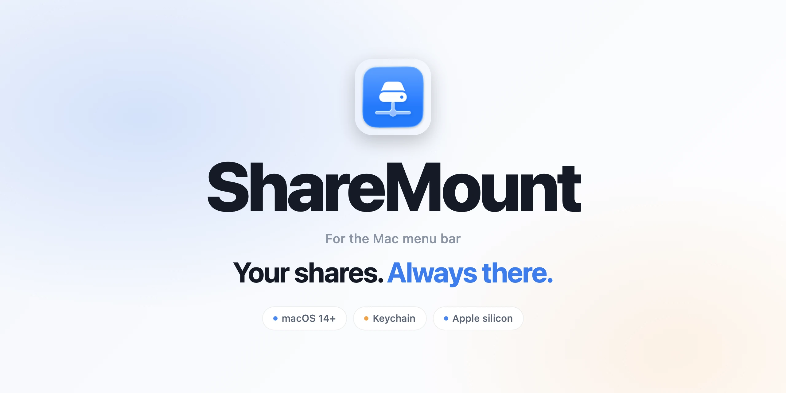

<div align="center">

<picture>
  <source media="(prefers-color-scheme: dark)" srcset="docs/images/readme-title-dark.webp" />
  
</picture>

[](https://github.com/SH1FT-W/sharemount/releases/latest)
[](#set-up)
[](https://github.com/SH1FT-W/sharemount/releases/latest)

<a href="https://sh1ft-w.github.io/sharemount"><b>Website</b></a>&emsp;<a href="#install">Install</a>&emsp;<a href="#set-up">Set up</a>&emsp;<a href="#menu">Menu</a>&emsp;<a href="#networks">Networks</a>&emsp;<a href="CHANGELOG.md">Changelog</a>

</div>

<br/>

ShareMount is a small menu bar app that **keeps your SMB shares mounted** and brings them back after sleep, network changes and NAS restarts. It uses the passwords macOS already keeps for the Finder.

macOS mounts a share once and then forgets about it: after a wake-up or a NAS reboot the share is gone or hangs, and scripts that expect `/Volumes/Media` find `/Volumes/Media-1`. ShareMount only handles SMB and never reads or stores your passwords itself.

## What it does when

| When | ShareMount |
|:--|:--|
| ShareMount starts, the Mac wakes, the network changes, once a minute | checks every share and mounts what is missing |
| The server stops answering on port 445, or reading the folder hangs twice in a row | unmounts the dead share and mounts it again, with retries from 30 seconds to 15 minutes |
| The Mac just woke up | unmounts nothing |
| An old mount is still in the way | keeps the share at `/Volumes/<name>` instead of `<name>-1` |
| The server rejects the login | stops retrying until you sign in again, so your NAS account is not locked |
| You are away from home | waits as *Away, paused* for shares limited to your networks |
| The server sleeps | sends Wake on LAN first, if you entered its MAC address |

**New in 26.10:** several users on one Mac (each sees only their own mounts, updates work from any account), Liquid Glass buttons on macOS 26 and 27, and servers with a plain IPv6 address. Every change is in the [changelog](CHANGELOG.md) and the [releases](https://github.com/SH1FT-W/sharemount/releases).

<a id="install"></a>
## Install

[](https://github.com/SH1FT-W/sharemount/releases/latest)

Unzip `ShareMount.zip` and move `ShareMount.app` to **Applications** (updates can only replace it there). ShareMount is not notarized by Apple (that needs a paid developer account), so macOS blocks the first launch once: open **System Settings > Privacy & Security**, scroll to *"ShareMount" was blocked* and click **Open Anyway**, or run

```sh
xattr -dr com.apple.quarantine /Applications/ShareMount.app
```

On macOS 14 you can also right-click the app and choose **Open**. After that ShareMount updates itself.

<details>
<summary>Build from source</summary>

No Xcode needed, the Command Line Tools are enough (`xcode-select --install`).

```sh
git clone https://github.com/SH1FT-W/sharemount.git
cd sharemount
./build.sh            # builds build/ShareMount.app (arm64, ad-hoc signed)
./build.sh install    # copies it to /Applications and launches it
```

</details>

<a id="set-up"></a>
## Set up

You need macOS 14 Sonoma or later (built and tested on macOS 27) on a Mac with Apple silicon. Intel Macs are not supported.

1. **Open the menu.** A drive icon appears in the menu bar (there is no Dock icon). Allow notifications and, if asked, access to the local network.
2. **Add your shares.** Choose **Settings… > Add** and type the share, pick a server found via Bonjour or paste an `smb://` address. **Import Connected** adopts shares you already mounted in the Finder.
3. **Sign in once.** If macOS has no password for a share yet, click it (or **Sign In…**), enter the password in the standard macOS window and tick **Remember this password in my keychain**.
4. **Turn on Open at Login** in the menu, so ShareMount is there after every restart.

With iCloud Drive on, the list of shares (not the passwords) is shared between your Macs.

<a id="menu"></a>
## Menu

Styled like the Wi-Fi and Bluetooth menus of macOS 26 and 27.

| In the menu | Shows or does |
|:--|:--|
| Share row | Free space and connection time. A click opens it in the Finder, connects it or asks you to sign in. |
| *Server not reachable* | The server does not answer on port 445. ShareMount keeps trying. |
| Key icon | The login was rejected. Click the share and sign in again. |
| *Away, paused* | The Mac is not on one of the share's networks. A click still connects, for example over a VPN. |
| *Fix Path* | The share sits at `Name-1`. Briefly disconnects and mounts it at `Name`. |
| Reconnect All, Disconnect All | For every share at once. |
| Settings… | Tabs Shares (Add, Edit, Import Connected), General, Updates and Log. |

Notifications come when a share is lost, a password is rejected or an update is out, at most once every 10 minutes per share. A click opens the right place in Settings.

<a id="networks"></a>
## Networks and Wake on LAN

**Only on certain networks.** In a share's settings, turn on *Only on certain networks* and click *Add Current Network* at home or in the office. Elsewhere the share waits as *Away, paused*: no attempts, no errors, no notifications. Networks you added to one share can be picked for the others under *Known*.

**Wake on LAN.** Enter the server's MAC address in the share's settings (it applies to every share on that server). If the server does not answer, ShareMount sends a magic packet, waits up to 60 seconds and then connects as usual; the next packet goes out after 5 minutes at the earliest, or right away when you click the share. The packet only goes out while the Mac is on one of the share's networks, so without networks set none is sent (the editor says so next to the MAC field).

> [!NOTE]
> Both settings are stored in `shares.json`. Older ShareMount versions drop them when they save the list, so update every Mac that shares the list through iCloud Drive first.

## Your data

- **Only your servers.** ShareMount talks to your SMB servers (port 445, the mount, Wake on LAN on your local network), browses Bonjour while the share editor is open and asks `api.github.com` for new releases. No analytics, no telemetry, no accounts.
- **Passwords** stay in the macOS keychain. ShareMount mounts through macOS (NetFS and NetAuth), which takes them from the entry the Finder creates.
- **No location.** Networks are recognised by the MAC address of their router, which macOS already knows. ShareMount never asks for Location Services and never reads Wi-Fi names.

## Good to know

- Each signed-in user runs their own ShareMount. If another user already holds `/Volumes/Name`, yours is mounted at `Name-1` on purpose, without a warning or a path fix.
- Over a full-tunnel VPN or on an IPv6-only network there is no router address to compare, so a share with network rules counts as away. A new router means adding the network again.
- Time Machine's hidden mounts under `/Volumes/.timemachine` are ignored.
- Updates are only installed with a valid Ed25519 signature from the maintainer's release key. Versions up to 26.10.7 only check the checksum; update them once to be covered.

<details>
<summary>Troubleshooting</summary>

- **"Server not reachable" although the NAS is on.** Allow ShareMount under **System Settings > Privacy & Security > Local Network**. VPNs and firewalls that block port 445 have the same effect.
- **The login is rejected (key icon).** Click the share, enter the correct password in the macOS window and tick *Remember this password in my keychain*.
- **The share is at `/Volumes/Name-1`.** macOS had not finished removing the old mount. ShareMount fixes its own mounts right away; for an existing mount it offers *Fix Path*, because a running app might have files open there. If an empty folder blocks the path, the menu shows the `sudo rmdir` command.
- **"Away, paused" at home.** The router was not recognised, for example after a new router or while a VPN routes all traffic. Click *Add Current Network* again; the log shows which router ShareMount sees.
- **Log:** `~/Library/Logs/ShareMount.log`.

When you open an [issue](https://github.com/SH1FT-W/sharemount/issues), the log helps.

</details>

<details>
<summary>Remove</summary>

1. Quit ShareMount and delete it from Applications.
2. Optionally remove the `ShareMount` folder in iCloud Drive > Software or in `~/Library/Application Support`, and `~/Library/Logs/ShareMount.log`.

The keychain entries belong to macOS and the Finder and stay where they are.

</details>

<details>
<summary>How it works</summary>

| File | What it does |
|:--|:--|
| `Sources/Engine.swift` | When to check (launch, wake, network changes, timer), back-off, dead-mount detection, path fixes |
| `Sources/Mounter.swift` | Mount (NetFS, soft mount, no dialogs), probe, unmount, all with timeouts |
| `Sources/Keychain.swift` | Where a password lives (macOS keychain via NetAuth, metadata only) |
| `Sources/NetworkRules.swift` | Which network the Mac is on (router MAC from the neighbour table), network rules, Wake on LAN |
| `Sources/Store.swift` | `shares.json` (iCloud Drive or Application Support), backup copy, log |
| `Sources/Updater.swift` | GitHub releases every 6 hours, Ed25519 signature, SHA-256 checksum, bundle ID, version and code signature checks, in-place swap with rollback |
| `Sources/Session.swift` | Fast user switching: keeps checking in the background, holds windows until the session is in front |

A share counts as hung when reading its folder takes longer than 10 seconds, twice in a row. Wake on LAN is a UDP broadcast on port 9. Wi-Fi names would need Location Services since macOS 14, and because ShareMount is only ad-hoc signed, macOS would ask again after every update; the router address needs no permission. The private release key never leaves the maintainer's Mac, so even someone who takes over the GitHub account cannot get an update installed.

</details>

<details>
<summary>Development</summary>

```sh
./build.sh test       # runs the self tests
./build.sh snapshot   # renders the screenshots in docs/screenshots with demo data
SHAREMOUNT_LANG=en /Applications/ShareMount.app/Contents/MacOS/ShareMount   # or =de
```

`build.sh` prefers a macOS 26 SDK from the Command Line Tools (the SDK 27 there lacks the SwiftUI macro plugin); override with `SDK=/path/to/sdk ./build.sh`. Every visible text is written as `L("German", "English")`; the app follows your Mac's first preferred language. Only Apple frameworks, no third-party code. Versions are `YY.M.N` (`26.10.4` is the fourth release of October 2026, newer than any `2.x`); releasing is described in [RELEASING.md](RELEASING.md).

</details>

## License

[MIT](LICENSE). Found a bug or missing something? [Open an issue](https://github.com/SH1FT-W/sharemount/issues).

<sub>ShareMount is an independent project, not affiliated with Apple. The screenshots use demo data.</sub>
