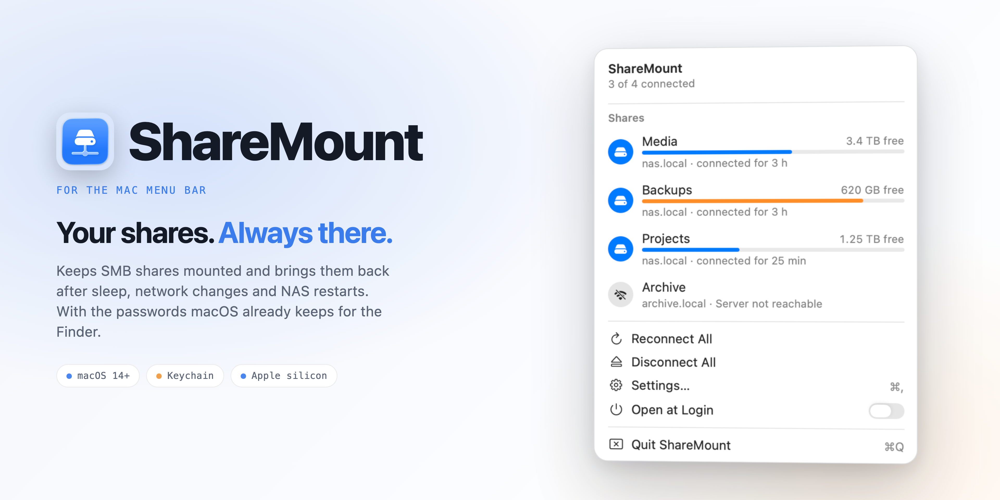
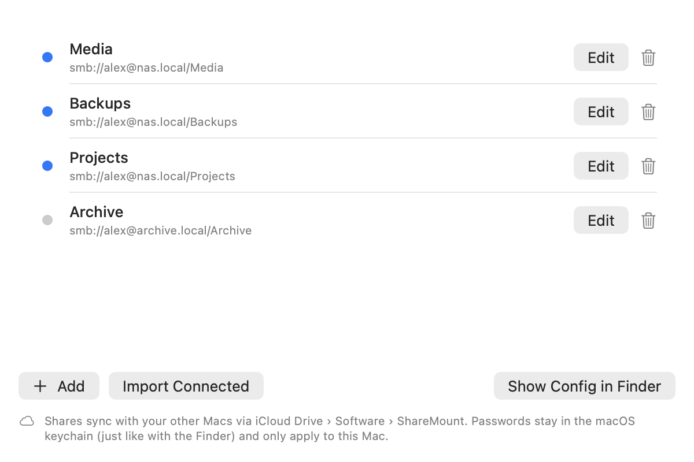
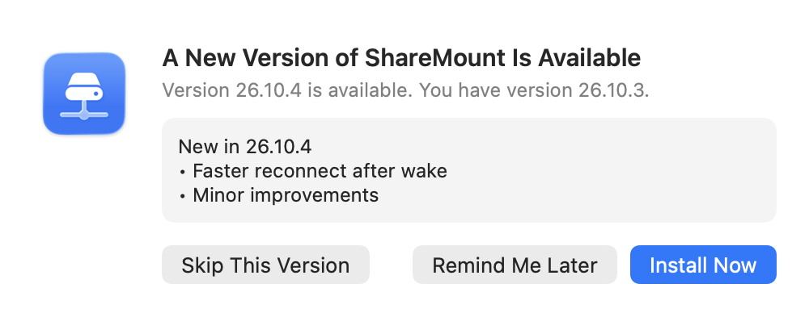

<div align="center">

<picture>
  <source media="(prefers-color-scheme: dark)" srcset="docs/images/readme-title-dark.png" />
  
</picture>

<p>A small menu bar app that keeps SMB shares mounted and brings them back after sleep, network changes and NAS restarts.<br/>
With the passwords macOS already keeps for the Finder.</p>

[](https://github.com/SH1FT-W/sharemount/releases/latest)
[](#install)
[](#install)
[](LICENSE)

<p><a href="https://sh1ft-w.github.io/sharemount"><b>Website</b></a> &nbsp;·&nbsp; <a href="https://github.com/SH1FT-W/sharemount/releases/latest"><b>Download</b></a> &nbsp;·&nbsp; <a href="#new">New</a> &nbsp;·&nbsp; <a href="#features">Features</a> &nbsp;·&nbsp; <a href="#how">How it works</a> &nbsp;·&nbsp; <a href="#privacy">Privacy</a> &nbsp;·&nbsp; <a href="#install">Install</a> &nbsp;·&nbsp; <a href="https://github.com/SH1FT-W/sharemount/releases">Releases</a></p>

<p><sub>The menu, styled like Wi-Fi and Bluetooth. English and German, following your Mac's preferred language. The screenshots use demo data.</sub></p>

</div>

<br/>

<a id="new"></a>
<sub><b>JUST ARRIVED</b></sub>
## One Mac. Several users.

The latest releases make ShareMount at home on a shared Mac, give its buttons the Liquid Glass look and switch to calendar versions.

| | |
|:--|:--|
| **Only your own mounts** <sub>2.5</sub> | With fast user switching, every signed-in user runs their own ShareMount. It only looks at the shares you mounted yourself and leaves the other users' mounts alone: they are never shown as yours or disconnected by you. If someone else already uses `/Volumes/Name`, yours is mounted at `Name-1` without a warning. While your session is in the background, checking and reconnecting go on; windows wait until you are back. |
| **Updates from any account** <sub>2.5</sub> | If the app belongs to another user, macOS asks for an administrator password and the app keeps its owner. After one user installs an update, ShareMount restarts by itself for the others. Mounts stay connected. |
| **Calendar versions** <sub>26.10.4</sub> | Year, month and the release of that month: 26.10.4 is the fourth release of October 2026. A new month starts again at .1. The jump from 2.5 is intended, the update check finds it as usual. |
| **Glass buttons** <sub>2.4.2</sub> | On macOS 26 and 27 the install and notice buttons use the Liquid Glass style, and the menu rows follow the window corners. |
| **Quiet cleanup** <sub>2.4.1</sub> | Removed the code that once carried settings over from the old app identifier. Nothing changed for you, and the app got a little smaller. |

Every change, release by release, in the [releases](https://github.com/SH1FT-W/sharemount/releases).

<br/>

<a id="features"></a>
<sub><b>FEATURES</b></sub>
## Set it up once. Forget about it.

macOS mounts a network share once and then forgets about it. After the Mac wakes up, switches Wi-Fi or the NAS reboots, the share is gone, or worse, it hangs and the Finder beachballs. Scripts and backups that expect `/Volumes/Media` suddenly find `/Volumes/Media-1`. ShareMount watches your shares in the background and quietly fixes what macOS leaves broken.

- **Reconnects on its own.** Checks at launch, after wake, on every network change and on a timer (every minute by default). Lost shares come back on their own, with a growing back-off from 30 seconds to 15 minutes while a server is away.
- **No more beachballs.** A share counts as dead only if the server stops answering on port 445 or reading the folder hangs for more than 10 seconds, twice in a row. Then it is unmounted and mounted again. Right after wake or a network change it never unmounts anything.
- **Uses the macOS keychain.** ShareMount mounts through macOS (NetFS and NetAuth), which takes the password from the same keychain entry the Finder creates when you tick *Remember this password in my keychain*. The app never reads or stores your passwords.
- **Clean paths.** Keeps shares at `/Volumes/<name>` instead of `/Volumes/<name>-1`, so scripts and backups always find them, and tells you if a leftover folder is in the way.
- **Gentle with your NAS.** If a server rejects the login, ShareMount stops retrying until you sign in again, so your NAS account is not locked out.
- **All your Macs.** With iCloud Drive, the list of shares (not the passwords) is shared between all your Macs. Passwords stay in each Mac's keychain.
- **Native menu.** Designed like the Wi-Fi and Bluetooth menus of macOS 26 and 27, with free space per share, connection time and one click to open, disconnect or reconnect. On macOS 26 and 27 the buttons use the Liquid Glass style and the menu rows follow the window corners.
- **Easy setup.** Add shares by hand, pick a server found via Bonjour, paste an `smb://` address, or adopt shares that are already mounted in the Finder.
- **Several users on one Mac.** With fast user switching, every signed-in user runs their own ShareMount and only sees their own mounts (see [New](#new)).
- **Notifications** when a share is lost, a password is rejected or an update is available, at most once every 10 minutes per share.
- **Updates from GitHub Releases**, verified before anything is replaced (see [Updates](#updates)).

<div align="center">
<picture>
  <source media="(prefers-color-scheme: dark)" srcset="docs/screenshots/settings-shares-dark.png" />
  
</picture>

<p><sub>Settings: your shares, synced between your Macs through iCloud Drive if you like.</sub></p>
</div>

<br/>

<a id="how"></a>
<sub><b>HOW IT WORKS</b></sub>
## Careful, not busy.

ShareMount checks at launch, after wake, on every network change and once a minute. A share counts as dead only when the server stops answering or reading the folder hangs, twice in a row. Only then is it unmounted and mounted again.

| | |
|:--|:--|
| **445** | A quick check on the SMB port tells whether a server is reachable at all. |
| **10 s** | If reading a folder takes longer than that, twice in a row, the mount counts as hung. |
| **0** | passwords in ShareMount. It mounts through macOS, which takes them from the keychain. |

<details>
<summary><b>Inside the source</b></summary>
<br/>

| File | What it does |
|---|---|
| `Sources/Engine.swift` | When to check: launch, wake, network changes, timer; back-off; dead-mount detection; path fixes |
| `Sources/Mounter.swift` | Mount (NetFS, soft mount, no dialogs), probe, unmount, all with timeouts |
| `Sources/Keychain.swift` | Where a password lives (macOS keychain via NetAuth, metadata only), optional GitHub token file |
| `Sources/Store.swift` | `shares.json` (iCloud Drive or Application Support), backup copy, log |
| `Sources/Updater.swift` | GitHub releases, checksum, signature and bundle checks, in-place swap, administrator swap when the app belongs to another user |
| `Sources/Session.swift` | Fast user switching: keeps checking in the background, holds windows until the session is in front again |
| `Sources/*View.swift`, `Components.swift` | Menu, settings and update window (SwiftUI) |
| `Sources/Lang.swift` | Picks English or German; every visible text is written as `L("German", "English")` |

</details>

<br/>

<a id="privacy"></a>
<sub><b>PRIVACY</b></sub>
## Private by design.

- **No tracking.** No analytics, no telemetry, no accounts. There is nothing to sign up for.
- **Only your servers.** ShareMount talks to your own SMB servers (a quick check on port 445, then the mount), browses for SMB servers via Bonjour on your local network while the share editor is open, and asks `api.github.com` for new releases. Nothing else.
- **Passwords** stay in the macOS keychain and are only used by macOS itself.
- **Plain files.** Your list of shares (server, share name, user name) is stored as a readable `shares.json` in iCloud Drive › Software › ShareMount when iCloud Drive is on, otherwise in `~/Library/Application Support/ShareMount`. The log is at `~/Library/Logs/ShareMount.log`.

<br/>

<a id="install"></a>
<sub><b>INSTALL</b></sub>
## Ready in a minute.

ShareMount is open source and signed locally, not notarized by Apple (that needs a paid developer account), so macOS asks once before the first launch.

1. **Download** `ShareMount.zip` from the [latest release](https://github.com/SH1FT-W/sharemount/releases/latest) and unzip it.
2. **Move** `ShareMount.app` to your **Applications** folder. Updates can only replace the app from there.
3. **Allow the first launch.** Open **System Settings › Privacy & Security**, scroll down to *"ShareMount" was blocked* and click **Open Anyway**. Or in Terminal:
   ```sh
   xattr -dr com.apple.quarantine /Applications/ShareMount.app
   ```
   On macOS 14 you can also right-click the app and choose **Open**.
4. **Add your shares.** A drive icon appears in the menu bar (there is no Dock icon). Open the menu and choose **Settings…**, then **Add**, or **Import Connected** to adopt shares you already mounted in the Finder.

From then on ShareMount takes care of itself, updates included. A few things for the first run:

- If macOS has no password for a share yet, click the share (or **Sign In…**). The standard macOS login window appears; tick **Remember this password in my keychain**. From then on ShareMount connects without asking.
- Allow notifications and, if asked, access to the local network.
- Turn on **Open at Login** in the menu so it is there after every restart.

### What you need

- macOS 14 Sonoma or later (built and tested on macOS 27)
- A Mac with Apple silicon. Intel Macs are not supported.
- Local network access and notifications
- iCloud Drive, if you want the list of shares synced between Macs

English and German interface, following your Mac's preferred language. Built with Apple frameworks only, no third-party code.

<a id="updates"></a>
### Updates

ShareMount checks the [GitHub releases](https://github.com/SH1FT-W/sharemount/releases) of this repository shortly after launch and every 6 hours (you can turn that off). When a new version is out, a small window offers *Install now*, *Later* or *Skip this version*.

<div align="center">
<picture>
  <source media="(prefers-color-scheme: dark)" srcset="docs/screenshots/update-dark.png" />
  
</picture>
</div>

Before the app is replaced, ShareMount checks that the download matches the published SHA-256 checksum, that it is ShareMount (bundle identifier) with exactly the announced version, and that its code signature is intact. The new version then replaces the old one in place; if that fails, the old version is put back.

Because ShareMount is ad-hoc signed and the checksum is published in the same release, these checks protect against broken or mixed-up downloads. They cannot protect against a compromised GitHub account, so an update is exactly as trustworthy as this repository's releases.

No GitHub account or token is needed. A read-only token can be entered under *Settings › Updates › GitHub Token (optional)*, which is only useful for a private fork.

**Several users on one Mac.** Updates work from any account. If the app in Applications belongs to another user, macOS asks for an administrator password; the app keeps its owner. When one user installs an update, ShareMount restarts by itself for the other signed-in users, and their mounts stay connected. The update window never opens while your session is in the background; it waits until you switch back.

### Versions

Since 26.10.4, ShareMount uses calendar versions **`YY.M.N`**: two-digit year, month without a leading zero, and the running number of the release within that month. `26.10.4` is the fourth release of October 2026; the next month starts again at `.1`. Every release, feature or fix, gets the next number. The jump from 2.5 to 26.10.4 is intended: the update check compares the numbers part by part, so any calendar version is newer than any `2.x` and the update is found as usual. How a release is made is described in [RELEASING.md](RELEASING.md).

### Build from source

No Xcode needed, the Command Line Tools are enough (`xcode-select --install`).

```sh
git clone https://github.com/SH1FT-W/sharemount.git
cd sharemount
./build.sh            # builds build/ShareMount.app (arm64, ad-hoc signed)
./build.sh install    # copies it to /Applications and launches it
./build.sh test       # runs the self tests
./build.sh snapshot   # renders the screenshots in docs/screenshots with demo data
./build.sh release next "What's new"   # maintainers: next calendar version, build, tag, GitHub release
```

`build.sh` prefers a macOS 26 SDK from the Command Line Tools (the SDK 27 there lacks the SwiftUI macro plugin) and falls back to the default SDK. Override with `SDK=/path/to/sdk ./build.sh`. Only Apple frameworks are used, no third-party code.

<br/>

<a id="faq"></a>
<sub><b>FAQ</b></sub>
## Questions that come up.

**A share shows "Server not reachable" although the NAS is on.**
Check *System Settings › Privacy & Security › Local Network* and make sure ShareMount is allowed. VPNs and firewalls that block port 445 have the same effect.

**The login is rejected (key icon).**
ShareMount deliberately stops retrying so your NAS does not lock the account. Click the share, enter the correct password in the macOS window and tick *Remember this password in my keychain*.

**My share is mounted at `/Volumes/Name-1`.**
That happens when macOS had not finished removing the old mount. ShareMount fixes it right after its own mounts. For an existing mount it shows *Fix Path* in the menu, because a running app might have files open there. If an empty folder blocks the path, the menu shows the `sudo rmdir` command to remove it.

**Another user on this Mac has the same share mounted.**
Each user runs their own ShareMount and only sees their own mounts. If the other user already holds `/Volumes/Name`, yours is mounted at `Name-1` on purpose, without a warning or a path fix.

**Does it work with Time Machine shares?**
Yes. ShareMount ignores the hidden mounts Time Machine creates under `/Volumes/.timemachine`.

**How do I uninstall it?**
Quit ShareMount, delete it from Applications, and optionally remove the `ShareMount` folder in iCloud Drive › Software or `~/Library/Application Support`, and `~/Library/Logs/ShareMount.log`. The keychain entries belong to macOS and the Finder and stay where they are.

**Which languages are supported?**
English and German. The app picks German when your Mac's first preferred language is German and English otherwise. To try the other language, start it from Terminal with `SHAREMOUNT_LANG=en` or `SHAREMOUNT_LANG=de`, for example `SHAREMOUNT_LANG=en /Applications/ShareMount.app/Contents/MacOS/ShareMount`.

<br/>

<sub><b>OPEN SOURCE</b></sub>
## A small, independent project.

ShareMount is a small, independent project under the [MIT license](LICENSE). Found a bug or missing something? [Open an issue](https://github.com/SH1FT-W/sharemount/issues) on GitHub.

ShareMount is not affiliated with Apple.

<br/>

<div align="center">
  <sub>A <a href="https://sh1ft-w.github.io"><b>SH1FT-W</b></a> project &nbsp;·&nbsp; <a href="https://sh1ft-w.github.io/casora">Casora</a> &nbsp;·&nbsp; <a href="https://sh1ft-w.github.io/flode">FLODE</a> &nbsp;·&nbsp; <a href="https://sh1ft-w.github.io/pulse">Pulse</a> &nbsp;·&nbsp; <a href="https://sh1ft-w.github.io/evenlight">Evenlight</a> &nbsp;·&nbsp; <a href="https://sh1ft-w.github.io/agentbar">AgentBar</a> &nbsp;·&nbsp; Built with <a href="https://claude.ai">Claude</a></sub>
</div>
